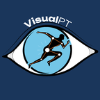

<div align="center">
  
  
  # VisualPT
  
  **A mobile app for physical therapy balance assessments**
  
  [](https://wakatime.com/badge/user/101a11b5-17a3-47c6-935c-58d4ffab60da/project/d93f104f-ff96-4d7d-bca8-5e54d6a0f910)
  
  Built with Flutter • Powered by AWS Amplify
</div>

---

## 📖 The Story

What started as a college dream to revolutionize physical therapy assessment tools became something even more valuable—a stepping stone.

This project began with big ambitions: build an iOS app that could help physical therapists conduct balance assessments (like the [CTSIB](https://www.sralab.org/rehabilitation-measures/clinical-test-sensory-interaction-balance) and [Berg Balance Scale](https://www.sralab.org/rehabilitation-measures/berg-balance-scale)) using motion tracking and sensor data. We dove headfirst into Flutter, AWS Amplify, GraphQL APIs, and iOS development. We learned about healthcare workflows, accessibility requirements, and the real challenges of building products that matter.

Did we change the world of physical therapy? Not quite. But we changed ourselves.

The late nights debugging CocoaPods, the architecture debates, the pivot from one approach to another—every "failure" was really just a lesson in disguise. This codebase represents hundreds of hours of learning, collaboration, and growth. It taught us how to build real software, how to work as a team, and how to pick ourselves up when things didn't go as planned.

**So here it is—open sourced for anyone who might find it useful, educational, or just wants to see what happens when a group of students dreams big.** Maybe you'll find a clever pattern to borrow. Maybe you'll learn from our mistakes. Either way, we hope you enjoy exploring it as much as we enjoyed building it.

*Here's to the next chapter.* 🚀

---

## ✨ Features

- **Balance Assessments** — Conduct standardized PT tests including CTSIB and Berg Balance Scale
- **Motion Analysis** — Leverage device sensors and KinesteX SDK for movement tracking
- **Patient Profiles** — Manage patient data with secure AWS Amplify backend
- **Trend Visualization** — Chart and analyze patient progress over time
- **PDF Reports** — Generate and email assessment reports

---

## 🛠️ Getting Started

> **Warning**
>
> Setting up this dev environment can be a tricky process, as you will need to install various systems to run a debuggable iOS application on your machine. Any sticky errors that show up during this process should be documented and added to a [New Discussion](https://github.com/VisualPT/visualPT/discussions/new?category=q-a) to accelerate future onboarding experiences, thank you.

### Prerequisites

- [VSCode](https://docs.flutter.dev/tools/vs-code) with Flutter extension
- [XCode](https://apps.apple.com/us/app/xcode/id497799835?mt=12) (Mac only)
- [Flutter SDK](https://docs.flutter.dev/get-started/install) (>= 3.29.0)
- [Amplify CLI](https://docs.amplify.aws/cli/)
- iOS device (>= iOS 14) — *Simulator won't work for camera features*

### Installation

Clone this repository and navigate to the project directory:

```bash
git clone https://github.com/VisualPT/visualPT.git
cd visualPT
```

Install Flutter and iOS dependencies:

```bash
# Get Flutter/Dart packages
flutter pub get

# Get iOS platform dependencies
cd ios && pod install && cd ..
```

### Configuration

Before running the application, set up your configuration files:

<details>
<summary><strong>1. Environment Variables</strong></summary>

Copy `.env.example` to `.env` and fill in your API keys:

```bash
cp .env.example .env
```

Edit `.env` with your KinesteX API key.
</details>

<details>
<summary><strong>2. AWS Amplify Configuration</strong></summary>

**Option A — Using Amplify CLI (Recommended):**

```bash
npx ampx sandbox --outputs-format dart --outputs-out-dir lib
```

This creates `amplify_outputs.json` and `lib/amplify_outputs.dart` with your AWS resources.

**Option B — Manual configuration:**

```bash
cp amplify_outputs.example.json amplify_outputs.json
cp lib/amplify_outputs.dart.example lib/amplify_outputs.dart
```

Then fill in your AWS resource IDs in both files.
</details>

> ⚠️ **Important**: Never commit `.env`, `amplify_outputs.json`, or `lib/amplify_outputs.dart` to version control.

### Build & Run

```bash
# Build for iOS
flutter build ios

# Run in debug mode (connect your device first)
flutter run
```

---

## 🏗️ Architecture

See [VisualPT Architecture Discussion](https://github.com/VisualPT/visualPT/discussions/41) for details on the app structure.

```
lib/
├── core/           # Shared utilities and base classes
├── features/       # Feature modules
│   ├── analysis/   # Motion analysis
│   ├── assessment/ # PT assessments (CTSIB, Berg, etc.)
│   ├── capture/    # Data capture
│   ├── chart/      # Visualization
│   ├── email/      # Report generation
│   ├── profile/    # Patient management
│   └── trend/      # Progress tracking
└── models/         # Data models
```

---

## 🙏 Acknowledgments

- **[Dad](https://github.com/Timothyrichpt)** — The man with the vision
- **The Flutter & Amplify communities** — For the docs, Stack Overflow answers, and open source tools
- **[Cole](https://github.com/bonesrnd), [Nick](https://github.com/drbubbles42)**, **[Evan](https://github.com/evanlevy43)** — Every line of code, every code review, every late-night debugging session

---

## 📄 License

This project is open source and available for learning and inspiration. Feel free to explore, fork, and build upon it.

---

<div align="center">
  <sub>Built with ❤️ for the game for a dude who wont ever just do it for the money</sub>
</div>
